# CT 11 — Chaining Hash Tables: Diagram Index

Every diagram in this repository, in the order the code refers to it.
The source files point at these with `? SEE DIAGRAM:` comments right where
they are relevant — this file is the index, not a replacement for reading
them in place.

PNG is used throughout rather than the SVG copies in `svgs/`: Weber's Canvas
rejects SVG on course import, and VS Code's markdown preview drops any SVG
carrying a `<style>` block. Both formats are in the repository; the PNGs are
the ones guaranteed to render everywhere.

---

## Header Diagrams

### 1. Hash Table Overview
*`ChainNode.h` — big picture: key → hash → index → bucket*

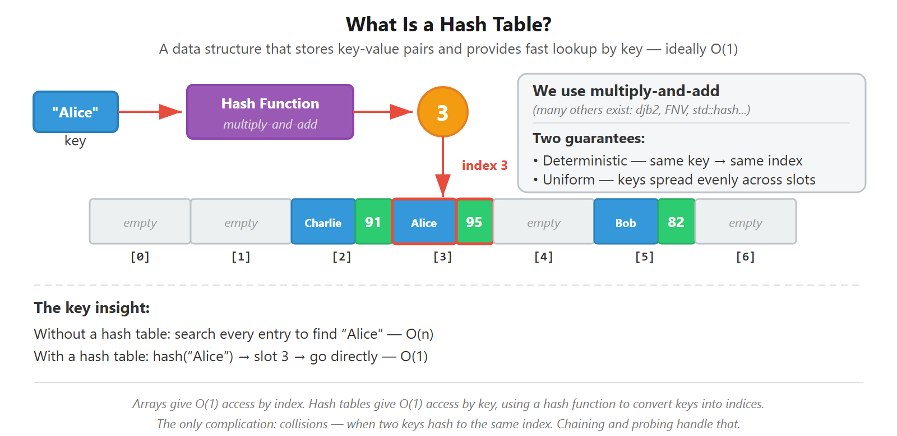

---

### 2. Chain Node Structure
*`ChainNode.h` — key/value/next fields*

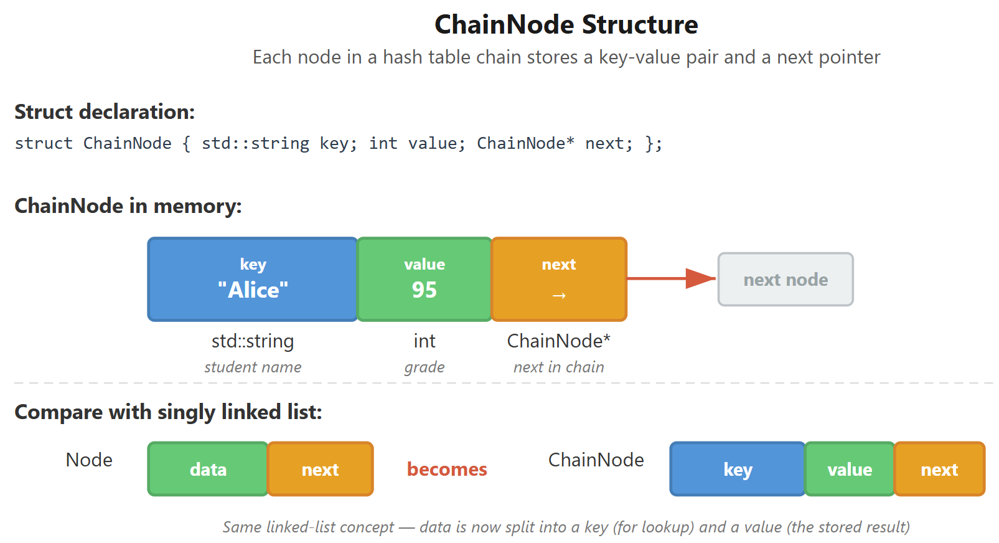

---

### 3. Bucket Chain
*`ChainingHashTable.h` — one bucket is just a linked list*

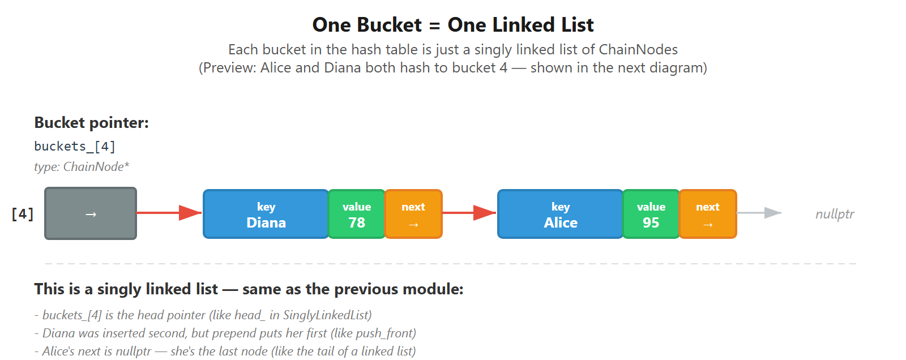

---

### 4. Chaining Hash Table
*`ChainingHashTable.h` — full bucket array with chains*

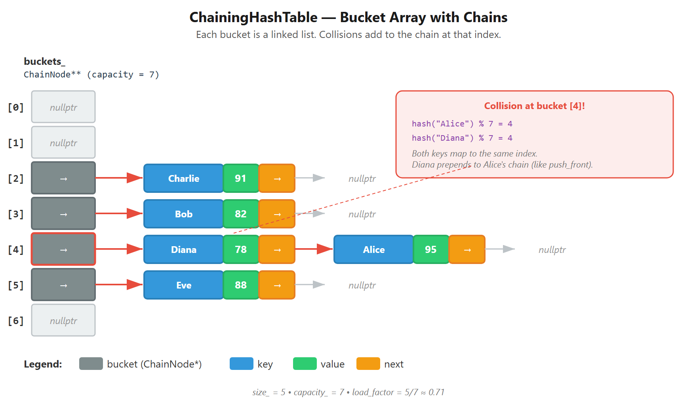

---

### 5. Load Factor Resize
*`ChainingHashTable.h` — before/after resize*

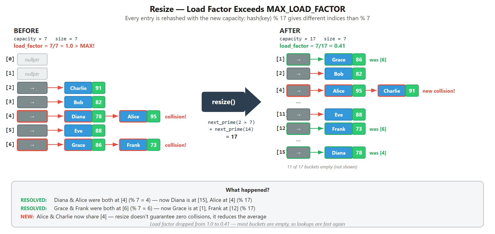

---

## Implementation Diagrams

### 6. Bucket Array Init
*`ChainingHashTable.cpp` — empty bucket array, all nullptr*

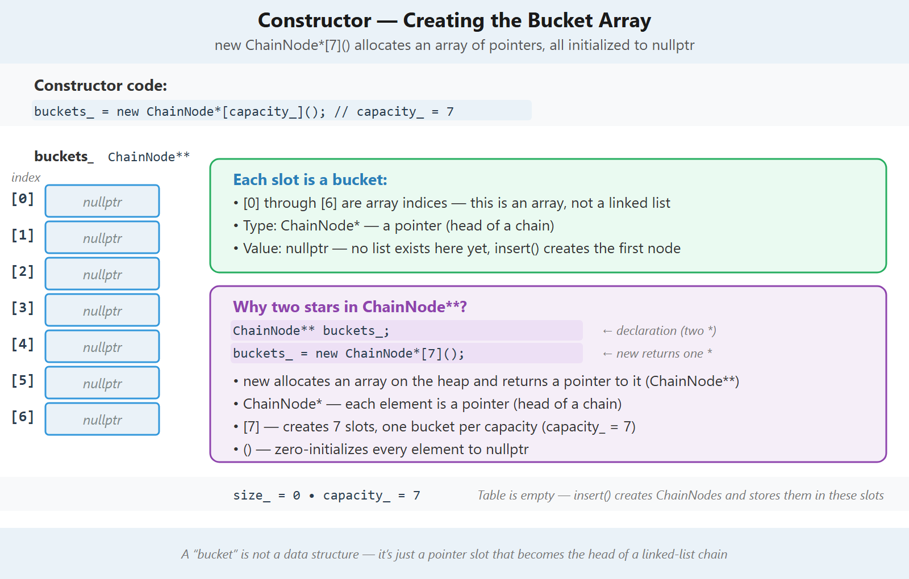

---

### 7. Prime Capacity
*`ChainingHashTable.cpp` — even vs. prime capacity distribution*

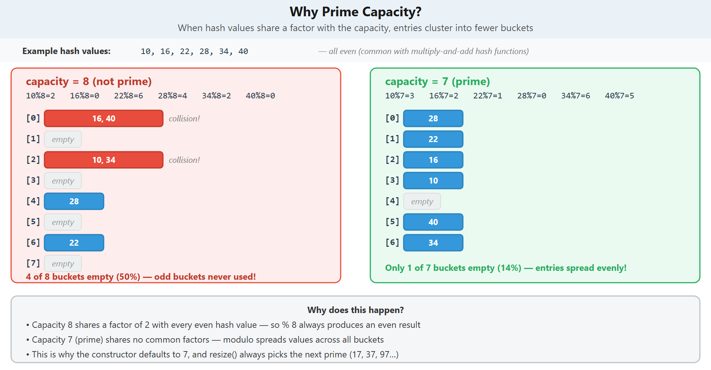

---

### 8. Multiply And Add
*`ChainingHashTable.cpp` — multiply-and-add process*

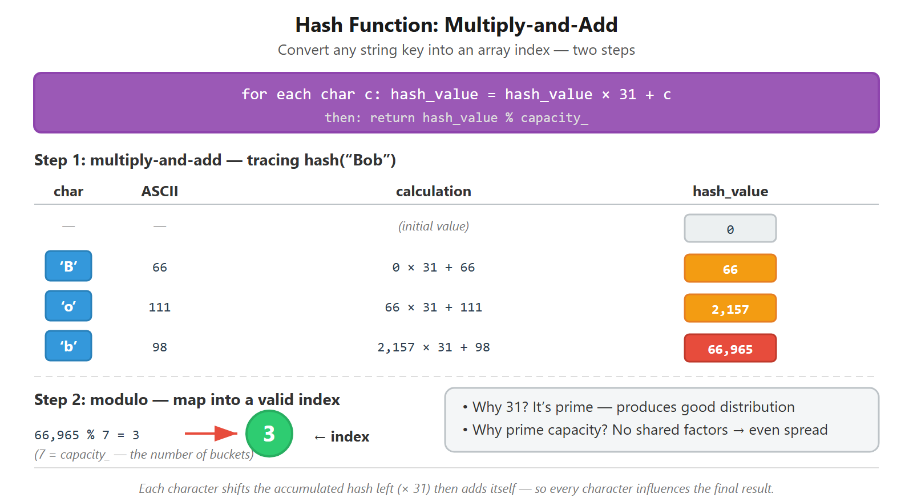

---

### 9. Chaining Insert
*`ChainingHashTable.cpp` — two cases: update or prepend*

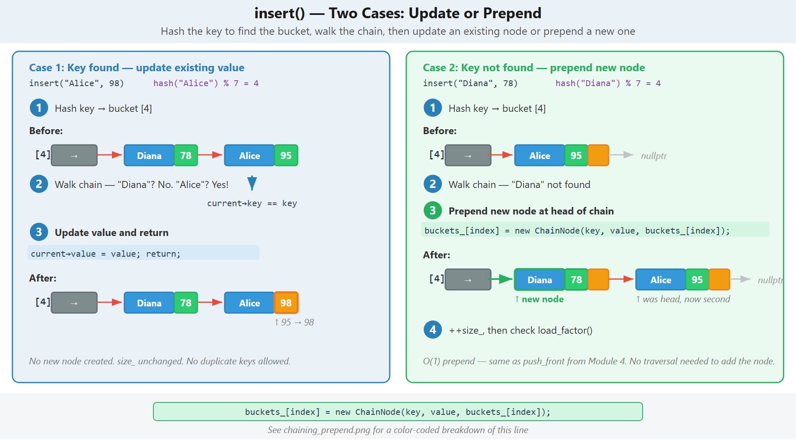

---

### 10. Chaining Prepend
*`ChainingHashTable.cpp` — color-coded breakdown of the prepend one-liner*

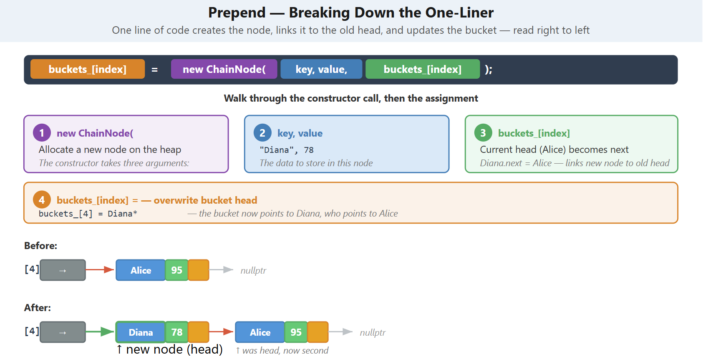

---

### 11. Chaining Search
*`ChainingHashTable.cpp` — found vs. not found*

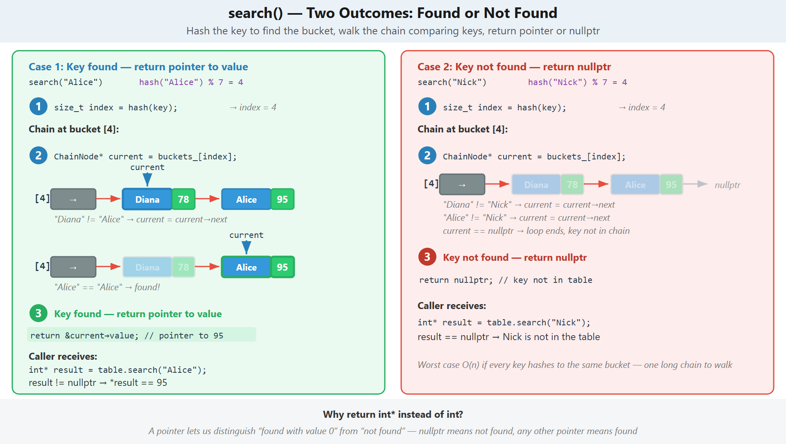

---

### 12. Chaining Remove Head
*`ChainingHashTable.cpp` — case 1: key at head*

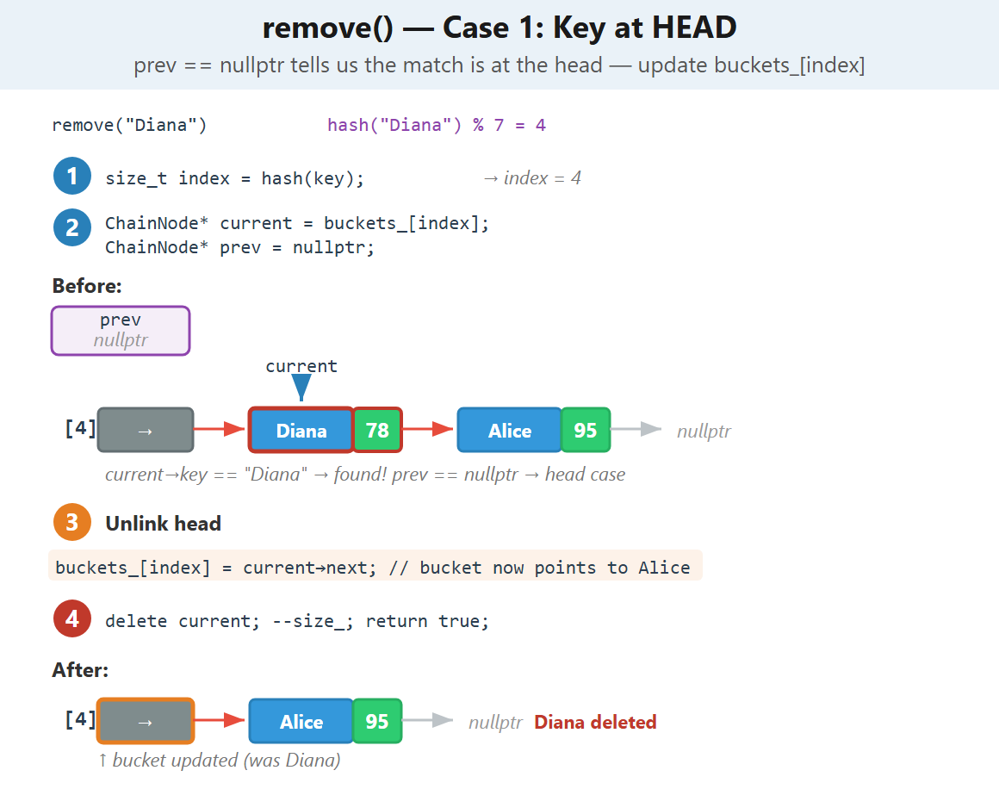

---

### 13. Chaining Remove Middle
*`ChainingHashTable.cpp` — case 2: key in middle/tail*

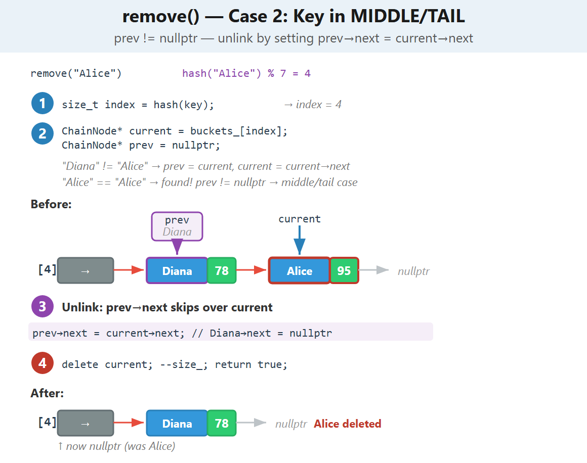

---

### 14. Chaining Remove Notfound
*`ChainingHashTable.cpp` — case 3: key not found*

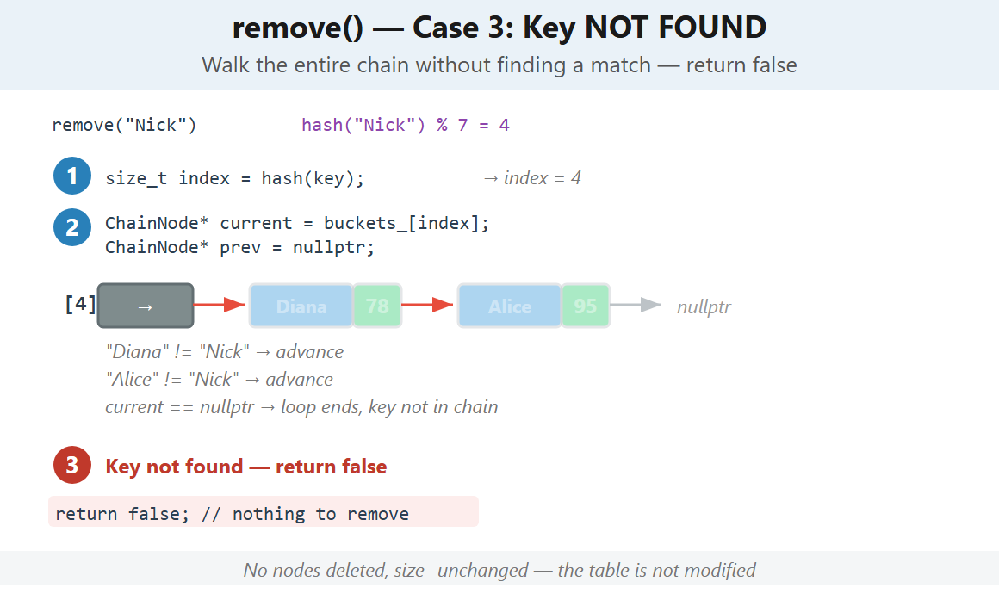

---
